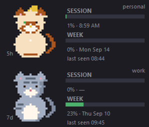
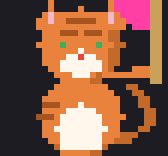
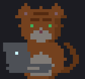
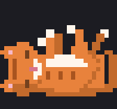
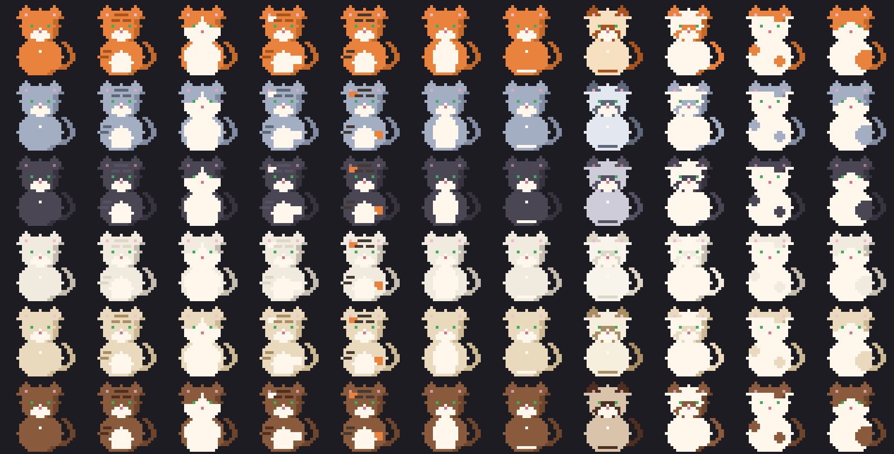

# Tokitty

<p align="center">
  
  
</p>

<p align="center">
  
  
  
  
  
</p>

<p align="center">
  <a href="https://github.com/nickwolf/tokitty/actions/workflows/ci.yml"></a>
</p>

A cat-themed desktop widget, built on Qt, that shows your live Claude Code and Codex usage (session %, weekly %, reset countdowns, and extra-usage credits) with a pixel cat whose mood reflects how close you are to the limit. When a limit is capped, the cat rests, then stirs, then wakes up as the reset approaches, then hops back to sleep once usage clears. Does not assist with boredom and existential dread upon hitting weekly limit.

Once Tokitty has a snapshot, it keeps counting down on its own clock, so it needs no live connection to know when a known reset time arrives. If a poll fails (for example, the OAuth access token going stale between Claude Code sessions), Tokitty keeps showing that same cached countdown rather than blanking out, and only surfaces a small warning once the countdown should already be done and it still can't confirm the reset actually happened.

There is a burn-rate projection too. When your current pace would hit a cap before the window resets, the status line says when: `session caps ~6:20 PM`. It tracks whichever limit lands first, and stays blank when you are coasting.

**Not affiliated with Anthropic or OpenAI (but I am open to it with either, *wink wink*).** "Claude" and "Claude Code" are Anthropic's marks, and "Codex" and "OpenAI" are OpenAI's, used here only to describe compatibility.

## The widget

Right-click a cat or card, or the tray icon (the cat in the menu bar on macOS), for the same menu everywhere: Refresh now, View, Always in front, Settings…, About Tokitty and Exit. On macOS Tokitty is a menu-bar app, so it has no Dock icon and no app menu of its own. The menu also carries an **Update to vX.Y.Z…** item while a newer release exists.

Clicks on the empty area around the cards and cats pass through to the window behind. **Always in front** keeps the panes above other windows and starts on at every launch.

The first time it runs, a short walkthrough (Welcome, Accounts, Live activity, Done) finds your Claude Code and Codex installs and offers to add them and install their hooks. **About Tokitty** shows the version, the links and the licence notices.

## Install

Download the matching archive from [GitHub Releases](https://github.com/nickwolf/tokitty/releases): `tokitty-<version>-windows-x64.zip` for Windows, `tokitty-<version>-macos-arm64.zip` for Apple Silicon Macs, `tokitty-<version>-macos-x86_64.zip` for Intel Macs, `tokitty-<version>-linux-x86_64.tar.gz` for Linux. Unzip it anywhere and run `Tokitty.exe`, `Tokitty.app`, or `tokitty`. These builds are unsigned, so Windows and macOS block the first launch until you clear their warning; see below for each OS. The builds need macOS 14 or later, Windows 10 version 1809 or later, or Linux x86_64 with glibc 2.35 or newer (Ubuntu 22.04 or newer).

With a downloaded build, hooks (the live activity feature below) need Claude Code 2.1.139 or newer, the first version that can run a hook command without a shell. They run through a link that Tokitty repoints at itself every time it starts (`current`, inside its per-user state directory), so after unpacking a release by hand or moving the folder to a new location, launch the new copy once before deleting the old one. The in-app update (see [Updating](#updating)) does that for you. Open Claude Code sessions keep working across that switch and nothing needs re-approving. If Tokitty can't set up the link, it says so and points hooks at the release folder directly, which means re-approving them in Codex and restarting open Claude Code sessions after every update.

### Windows

SmartScreen blocks the first launch because the build is unsigned. Click **More info**, then **Run anyway**.

If your Claude Code home lives inside WSL, the common setup on Windows, its hook keeps running through WSL's own `python3`, not the Windows download.

### macOS

Apple Silicon Macs take the `macos-arm64` build, Intel Macs take `macos-x86_64`.

On macOS 15, Gatekeeper doesn't let Control-click ▸ Open bypass the warning. Open the app once, then go to System Settings ▸ Privacy & Security ▸ Open Anyway, or skip the dialog with `xattr -dr com.apple.quarantine Tokitty.app` from a terminal.

Move Tokitty to Applications before turning on **Start at login** or adding an account. Run straight from Downloads, it refuses and says why: macOS runs a freshly downloaded app from a random, read-only App Translocation path, so there's nowhere stable for a login item or a hook to point at.

### Linux

Nothing to do on first launch. The build uses Qt's X11 (xcb) platform; on a Wayland desktop it runs through XWayland.

On Debian or Ubuntu the only package to install is `sudo apt install libegl1`, which some minimal desktops leave out. The other X11 libraries Qt needs are inside the archive. Translucency on Linux depends on your compositor and is best-effort.

## Updating

Tokitty checks GitHub Releases for a newer version about a minute after startup and then once a day, and it never installs anything without a click. **Check for updates automatically** in Settings ▸ General turns the daily check off. **Check now** in the same place runs one on demand, whatever that setting is.

When a newer release exists, **Update to vX.Y.Z…** appears at the top of the right-click menu and, where there is one, the tray menu. On Windows the tray also shows one notification per version. The Linux tray has no notifications and neither does the macOS menu-bar cat, so the menu item is the only notice there. The item opens a dialog with Install, Release notes and Later.

Install downloads the archive for your platform, checks it against the release's `SHA256SUMS`, unpacks it, and runs the new build's self-check before touching anything. On Windows and Linux the new copy goes into a new `v<version>` folder next to the current one, so `releases\v0.6.2\Tokitty` becomes `releases\v0.7.0\Tokitty`. On macOS the new bundle is swapped in at the same path, and that folder has to be writable. A standard user with Tokitty in `/Applications` gets the release page instead, and so does a bundle that isn't named `Tokitty.app`.

The old copy keeps running until the new one has started and reported back. If the new copy hasn't come up after two minutes, the old one stays (on macOS the swap is undone) and says so. Hooks and Start at login follow the new copy once it starts.

Tokitty keeps the copy it just replaced and deletes older copies it installed. On macOS the kept copy is a hidden `.Tokitty-<old tag>.app` beside the app. It only deletes what it installed itself, so folders you unpacked by hand are never touched, even when they sit in the same directory with a `v` name.

A run from source only reports updates, and its menu item opens the release page.

Each release has a `SHA256SUMS` file, and the updater refuses a download that doesn't match it. That catches a corrupted or tampered download. It does nothing about someone who can publish releases on the repo, and the builds are unsigned, so the trust is the same as downloading by hand.

### Rolling back

On Windows and Linux, launch the previous copy from its folder. It repoints `current` at itself, and its own check will offer the newer version again unless you turn the daily check off.

On macOS, quit Tokitty and run these in a terminal, with your own tags in place of `v0.6.2` and `v0.7.0`:

```bash
mv /Applications/Tokitty.app /Applications/.Tokitty-v0.7.0.app
mv /Applications/.Tokitty-v0.6.2.app /Applications/Tokitty.app
```

The first command parks the new version under a hidden name, the second puts the old one back. Swap the names again to go forward.

## Live activity (thinking / working / permission / done)

Optional, off by default. With a downloaded build, adding an account in the Accounts dialog installs its hooks automatically, and Settings ▸ Accounts shows each account's hook status with **Install hooks** and **Remove hooks** buttons. Or run the app from a terminal with `--install-hooks` (for example `Tokitty.exe --install-hooks` on Windows). From source, run:

```bash
python -m tokitty --install-hooks
```

and the cat reacts to what a running Claude Code session is doing: a thinking pose while Claude is composing a response, a working pose (with the tool name) while it's mid-tool-call, a flag when Claude is waiting on you for a permission prompt, and a little done-hop when a work stretch wraps up. `python -m tokitty --uninstall-hooks` removes it again (the hook entries, not the copied hook script and session state files, so delete `<config-dir>/tokitty/` manually if you want those gone). Existing running Claude Code sessions need to be restarted to pick up a fresh install or uninstall, since hook edits aren't hot-reloaded.

Installing also registers a `PermissionRequest` hook for the Stream Dock. It is inert unless a Stream Dock is connected: with no deck it prints nothing and Claude Code's own prompt is unaffected. Running Claude Code sessions pick it up after a restart.

A session nobody is watching (a scheduled `claude -p`, a remote-control server) can still hit a permission prompt, and a flag for it just means an empty room. Start those with `TOKITTY_QUIET=1` in the environment: their permission prompts raise no flag and never reach the Stream Dock, while the rest of their activity shows as usual.

On the primary Windows+WSL2 setup, Claude Code itself lives inside WSL, not in the Windows-native `~/.claude`. `--install-hooks` (and `--uninstall-hooks`) detect this automatically, using the same WSL-credentials probe the live-activity watcher uses, and target the `\\wsl.localhost\<distro>\home\<user>\.claude` dir instead, falling back to the Windows-local `~/.claude` only if WSL resolution fails (no WSL installed, no Claude Code credentials found, etc). Running `python3 -m tokitty --install-hooks` from inside WSL itself installs to the same dir and is equivalent, so pick whichever shell is convenient.

## Autostart

Optional, off by default. Open Settings ▸ General (right-click any pane or the tray icon, or the menu-bar cat on macOS, and choose **Settings…**) and check **Start at login** to have tokitty launch itself automatically the next time you log in: no installer, no admin rights, nothing outside your own user account. Unchecking it removes the same registration.

The mechanism is native to each OS and needs no third-party dependency: the `HKCU\Software\Microsoft\Windows\CurrentVersion\Run` registry value on Windows, a `LaunchAgent` plist at `~/Library/LaunchAgents/com.nickwolf.tokitty.plist` on macOS, and a `.desktop` file at `~/.config/autostart/tokitty.desktop` on Linux. The checkbox reflects the real OS registration, read when tokitty starts and again after you toggle it. Nothing is cached on disk, so removing the entry by hand is picked up the next time tokitty starts. It is not picked up mid-session: remove the entry externally while tokitty is running and the checkbox keeps showing the state it read at startup until you restart. On macOS, checking the box writes the plist but doesn't load it into the running session, so the change takes effect at your next login, not immediately.

`python -m tokitty --install-autostart` and `python -m tokitty --uninstall-autostart` do the same thing from the command line, for headless setup or scripting.

If tokitty's repo clone is moved, or the Python interpreter it was registered against changes, the registration can go stale and silently fail to launch at the next login with nothing on screen to explain it. tokitty checks for this itself at every startup and rewrites the registration if it's drifted, so as long as tokitty gets launched by hand at least once from wherever it now lives, the next automatic login launch self-heals. The one thing this can't fix: deleting the whole clone with no replacement leaves a permanently broken entry, since nothing is ever running to repair it. Uncheck **Start at login** (or run `--uninstall-autostart`) before deleting a clone that has autostart enabled.

## Accounts

Tokitty can track any number of Claude Code accounts side by side in one window: a pane per account instead of one, laid out in a grid once you're past four, sharing a single always-on-top card. With no accounts configured, tokitty shows a single pane for the Claude Code install it finds.

Open Settings ▸ Accounts and choose **Manage accounts…** to add, rename, or remove accounts, no config file editing needed. The dialog also lists any Claude Code installs it finds on its own (WSL installs only) as one-click rows next to a manual "add by path" entry for anything it didn't find. Adding an account rolls it a random look. Removing one only takes it out of the active list, and its saved colorway and pattern stay on disk in case you add it back later. If tokitty starts with no accounts configured and finds more than one usable Claude Code install, it opens the Accounts dialog on its own instead of guessing which one you meant.

After adding or removing an account, restart tokitty to see the new pane layout, and restart any already-open Claude Code sessions to pick up the hook change (hook registration isn't hot-reloaded into a running session).

Accounts live in `accounts.json` in tokitty's per-user state directory (the same directory as `position.json`, `%LOCALAPPDATA%\Tokitty\` on Windows, `~/Library/Application Support/Tokitty` on macOS, `$XDG_CONFIG_HOME/tokitty` or `~/.config/tokitty` on Linux), and the dialog is the supported way to manage it. Each entry's `config_dir` points at that account's Claude Code config directory (a WSL UNC path, a native path, whatever `--install-hooks` would target for that account); `name` is an opaque identity slug the dialog assigns on add, not something meant to be typed by hand.

`TOKITTY_CREDENTIALS` (see [Configuration](#configuration) below) works only when no accounts are configured. If both `TOKITTY_CREDENTIALS` and a valid `accounts.json` are present, `accounts.json` wins and the env var is ignored; tokitty prints a startup warning to stderr so the conflict doesn't pass silently.

Work-account tokens typically expire around an hour after that account's Claude Code last ran. Outside work hours, an idle account's pane will show its last-good numbers dimmed, a sleeping cat, and a "last seen HH:MM" label. That is the normal state for an idle account, so no error styling is applied.

Multi-account mode reads credential *files*. Each `config_dir` entry is read as `<config_dir>/.credentials.json`, so on macOS, where Claude Code stores credentials in the login Keychain, tokitty can't discover or add a second Keychain-backed account. When there's no credentials file on disk, the Accounts dialog shows a read-only "Default macOS account (Keychain)" row in place of a normal account row, since the Keychain holds one item per macOS user with no per-account identity to key on.

Setting `TOKITTY_DEBUG_ACCOUNTS=2` renders a fake two-pane card (one normal, one in the resting look) without needing any real accounts configured, handy for checking layout changes.

## Per-model usage

The bars described so far come from Claude Code's usage endpoint, which only answers for a subscription. If you pay per token with an API key, that endpoint has nothing to tell you, so there is a second view that reads Claude Code's own transcripts instead, under `<config-dir>/projects/`, and totals the tokens each model used. It needs no network, no credentials, and no subscription. Right-click a pane and pick **View ▸ Per-model** to switch, or **View ▸ Limits** to go back (the same choice is under Settings ▸ Usage). If tokitty finds transcripts and no credentials at all, it selects the per-model view for you on first run, and you can switch back at any time.

Each row is one model, with the tail folded into an `other (N)` row so what's on screen always adds up to the real total. **Usage window** in Settings ▸ Usage picks the last 24 hours, the last 7 days, or the current calendar month; switching between them is instant, because the scanner keeps a month of records in memory and re-totals them. **Readout** in the same place switches the figures between dollars and token counts. On a subscription those dollars are what the same work would have cost at API rates rather than anything you are billed, which is why the line says so, and why the token readout is the more honest one to leave it on.

Set a budget in Settings ▸ Usage and the bars change meaning: instead of each model's share of the window, they become a share of the budget, and the usual green/amber/red comes back with something real to measure against. Budgets are per account and per window, so $40 for a month and $40 for a day are different settings, and a blank entry clears one.

Both of these make the totals differ from a naive reading of the same files. A turn that made several API calls records each one separately, and the top-level total for that turn leaves out advisor calls, so tokitty adds up the individual calls and bills advisor calls against the model that actually ran them. The same message also gets rewritten several times inside one transcript, 4,037 of 5,817 entries on the machine this was built on, so only the last copy of each is counted.

Prices live in `tokitty/prices.json`, one section per provider, each stamped with the pricing page it came from and the date it was read. A model that isn't in it still has its tokens counted and shown, but its cost reads `--` and the total is marked `>=` rather than quietly pretending to be complete. Once any rate on screen is more than 60 days old, the status line says "at old API rates" instead of "at API rates".

To price a model before the next release, put a `prices.json` of the same shape in Tokitty's state directory (`%LOCALAPPDATA%\Tokitty`, `~/Library/Application Support/Tokitty`, or `~/.config/tokitty`). Its models replace the packaged ones entry by entry. An entry that only gives rates keeps the packaged long-context pricing for that model; set `"short_context_only": false` to make a model flat on purpose. A malformed override is ignored with a warning on stderr and in `--debug-print`, and the packaged prices stay in effect.

```json
{"schema": 1, "providers": {"mine": {"as_of": "2026-09-23", "models": {
  "gpt-7": {"input": 2.0, "output": 10.0, "cache_read": 0.2, "cache_write_5m": 2.5, "cache_write_1h": null}
}}}}
```

`python3 scripts/refresh_prices.py` rewrites the packaged file from the live Anthropic and OpenAI pricing pages and prints what was added, changed, and kept; `--check` only reports. It refuses to write if a page's columns no longer line up with its rates.

`python -m tokitty --debug-print` prints the same breakdown per account as text, which is the first thing to look at if a number looks wrong.

## Checking usage from an agent

`--debug-print` needs no display and exits when it's done, so a coding agent can run it in the middle of a task and read its own limits. For each account it prints a `session:` and a `weekly:` line, each with the percentage used and the reset time in UTC, followed by the per-model breakdown above.

I have Claude Code run `python3 -m tokitty --debug-print` at natural checkpoints in long sessions, before dispatching a subagent or starting a long build. When the weekly figure gets close to 100% it stops starting new work, commits what's finished, and writes down where it got to. Each run makes one usage request per account, the same one the widget makes on every poll.

Claude Code sessions also get told without asking. While the widget is running, a session's hook adds one line to its context the first time session or weekly usage reaches a threshold, for example `tokitty: weekly usage 95% (threshold 95%), resets Mon Oct 12 18:00 local, reading from 11:42 local`. The main session and each subagent are told once per limit window, and a subagent that starts after the crossing hears about it when it starts. The thresholds (90% session and 95% weekly by default) are under **Usage alerts** on the Settings window's Usage tab, and **Tell Claude Code sessions** there turns the notes off. The widget writes its last reading to `<claude home>/tokitty/usage.json` and makes no extra requests for this; a reading older than 15 minutes is ignored, so nothing is said while the widget is closed. Codex accounts don't get notes.

The same thresholds can also push a notification to your phone through [ntfy](https://ntfy.sh). Turn on **Send to ntfy** under **Usage alerts** on the Usage tab. The server is `https://ntfy.sh` by default, or the address of your own ntfy server. Switching it on generates a topic like `tokitty-3f9a1c0b7d42`; install the ntfy phone app and subscribe to that topic on the same server. Topics on ntfy.sh are public to anyone who knows the name, so keep the generated one private or use a self-hosted server. If your server requires login, paste an access token into **Access token**. Each limit window sends at most one notification per account, for Claude and Codex accounts alike, and the title and body hold only the account label, the percentage, the threshold and the reset time. **Send test** sends a sample message so you can check the setup.

## Codex

A pane can track an OpenAI Codex account instead of a Claude Code one. It gets the same limit bars (whichever windows your plan has) and the same Per-model view, both read from the rollout files Codex writes under `<codex-home>/sessions/` and `archived_sessions/`. Nothing is fetched and no credentials are read, so a Codex pane works offline.

Add one from the Accounts dialog: pick **Codex** as the harness, click **Add by path…**, and enter the Codex home (`C:\Users\<you>\.codex` on Windows, `~/.codex` elsewhere). Pointing it at the `sessions` folder inside works too. If your own Codex home has rollouts and isn't an account yet, the dialog lists it as a one-click row. Tokitty installs its hooks into the Codex home's `hooks.json` (and `--install-hooks` covers it), but never touches `config.toml`.

You can also add one by hand. The entry in `accounts.json` needs `"provider": "codex"` and `config_dir` pointing at the Codex home:

```json
{"name": "codex", "config_dir": "C:\\Users\\you\\.codex", "provider": "codex"}
```

Entries without a `provider` key are Claude Code accounts. An entry naming a provider this build doesn't know gets a pane that says so instead of numbers. When a window holds more than one harness, each pane's label gets a tag like `codex·nibbles` so you can tell them apart.

A few things behave differently from a Claude Code pane:

- Codex only records its rate limits when it takes a turn, so between sessions the bars are a snapshot. Past 10 minutes old, the status line says when it was taken ("as of 4:12 PM"), and the countdowns keep running on tokitty's own clock as usual.
- A Codex account gets live thinking and working poses once you approve Tokitty's hooks in the Codex CLI's hook review. Approval happens in the CLI, and the desktop app and IDE extension are untested.
- A Codex account that uses the automatic approval reviewer (`approvals_reviewer = "auto_review"`, or the legacy `guardian_subagent`, set at top level or in any profile) gets no permission pose, because Codex runs the hook before the reviewer decides and can't tell it whether a person will see the prompt.
- Costs use OpenAI's standard-tier API rates. Fast mode bills double and Batch and Flex half, but the rollouts don't say which tier a turn ran on.
- `codex-auto-review`, the automatic review pass, isn't on OpenAI's pricing page. Its tokens are counted and shown, but its cost reads `--` and the total is marked `>=`.
- Requests to models that OpenAI prices by context length (currently `gpt-5.6-sol`, `gpt-5.5`, and `gpt-5.4` over 272K input tokens) are costed separately, and show up as a `long` row where a long-context rate is published.

## Stream Dock

Windows only. A VSDinside Stream Dock can show your Claude Code sessions as keys (tested on the M18). Pressing a session's key brings its Windows Terminal tab to the front, and when a session is waiting on a permission prompt you can answer it from the deck with Allow, Deny or Always. Other keys show an account's usage, interrupt the session you last jumped to, or open a new Claude Code tab in a repo you choose. Tokitty does the work; a small plugin inside VSD Craft draws the keys and forwards presses to it over `127.0.0.1`.

To set it up:

1. Install the live activity hooks (above). The deck answers prompts through the same hook.
2. Run `python -m tokitty --install-streamdock` (or `Tokitty.exe --install-streamdock`). It copies the plugin into VSD Craft's plugins folder and picks a local port and a random token for it. `--uninstall-streamdock` removes it again. Settings ▸ Stream Dock has Install and Uninstall buttons for the same thing on Windows; restart tokitty afterwards to finish.
3. Fully exit VSD Craft from its tray icon and start it again, so it loads the plugin. Drag the Tokitty key action onto the keys you want, and pick each key's role in its settings panel: session slot, usage for an account, Interrupt, a new-session preset, or Blank for a key that stays empty.
4. Restart Tokitty, and restart any open Claude Code sessions so they pick up the hook.

After an update, Tokitty brings the installed plugin's files up to date when it starts (your port and token stay the same). VSD Craft only reads them when it starts, so exit it from its tray icon and start it again once to load the new plugin.

Running from source, `pip install comtypes` (or the `streamdock` extra) is needed for the tab switching and Interrupt keys. Everything else works without it.

Open Settings ▸ Stream Dock and choose **New-session presets…** to manage new-session presets. The dialog lists them and has Add, Edit and Remove. A preset is a name, a Claude account, and a folder: for an account on Windows the folder has a Browse button, and for an account in WSL it is a path inside WSL such as `/mnt/c/Tools` or `~/repo`. Tokitty works out the rest (WSL or native, and which distro) from the account, tells you why a preset can't launch, and saves it without a restart. Codex accounts aren't offered, since a new tab can only start Claude Code.

To edit by hand, presets live in `settings.json` in tokitty's state directory, one entry per key. `account` is the account's name from `accounts.json`, and a preset that names an account is never launched on a different one, even after you remove or reorder accounts. `account_index` is the account's position in the Accounts list, starting at 0, and is only used when `account` is absent. `env` is `wsl` (with `distro`) or `native`:

```json
"streamdock_presets": [
  {"name": "Tools", "account": "acct-v1-0a1b2c3d", "account_index": 0, "env": "wsl", "distro": "Ubuntu", "cwd": "/mnt/c/Tools"}
]
```

How answering from the deck works:

- Allow is only lit once Tokitty has confirmed the session's tab is the one in front. If it can't tell which tab is the session's (no tab with that title, two sessions with the same title, or a tab it can't bring forward), it opens a small window of its own with the full command and Allow and Deny buttons instead.
- Each key also has a "During a permission prompt" setting (Allow, Deny or Always), so any key, including a Blank one, can take a decision while a prompt is open. Decisions you don't assign come from the session and Interrupt keys in reading order, and the overlay opens as long as both Allow and Deny have a key.
- Always is offered only when the call has an exact rule: one Bash command with no `*` in it, one file path for Edit or Write, or a WebFetch domain. The rule lasts for that session only and is never written to a settings file.
- The terminal prompt keeps working the whole time, and whichever answer lands first wins.
- A command approved in the terminal that keeps running for a long time leaves its deck key flagged until it finishes, because Claude Code records nothing until the command returns. Answering from the deck doesn't have this problem.
- Tokitty can't see tabs in a Windows Terminal running as Administrator, so those sessions always get the popup window.
- The M18's ring isn't supported.
- Pressing a key that shows "no tab" removes that session from the deck until it asks for permission or ends, and the **Show sessions from** toggles in Settings ▸ Stream Dock turn accounts on and off.

## Customization

A cat's look is two independent axes: a **colorway** (its tone palette) times a **pattern** (which tone each body region takes). Right-click a pane, choose **Settings…**, and open Look to change either (its Editing picker starts on the pane you right-clicked). **Colorway** offers six (`orange`, `gray`, `black`, `white`, `cream`, `brown`) and **Pattern** offers nine (`solid`, `tabby`, `bicolor`, `tabby_white`, `calico`, `tuxedo`, `socks`, `colorpoint`, `van`). Picking either applies immediately and persists, so six colorways × nine patterns give 54 built-in looks. `colorpoint` and `van` pale the body toward the colorway's light tone, so they read best on the lighter colorways.

<p align="center">
  
</p>

Colorways run top to bottom in the order listed above, patterns left to right.

**Randomize** in Settings ▸ Look rolls a fresh colorway and pattern for that pane and saves it, and **Surprise me** (a toggle in Settings ▸ General, off by default) re-rolls every pane on each launch. Both only roll from the built-in colorways and patterns. A fresh install rolls one random look on first launch and keeps it.

**Cat sits** in Settings ▸ Look puts the cat on the Left or Right inside the card, or On top of it. On top is offered for panes in the first row of the grid.

Settings ▸ Look has a row with a **Change…** button per overridable piece (Coat, Shade, Card background, Bar fill). Each pick previews live, and **Reset to preset** clears all four back to the current colorway and pattern's stock colors.

Every per-pane choice is saved to `customization.json`, in the same per-user state directory as `position.json` (see [Accounts](#accounts) above for the exact path per OS). With no accounts configured the file has one entry keyed `"default"`, and with accounts it is keyed by each account's identity slug, so each pane keeps its own look and colors. It stores `colorway`, `pattern`, `cat_home` (`inside`, `inside_right` or `on_top`), the four color overrides and the label.

Each pane also gets a label under the sprite. Set one in the Name field of Settings ▸ Look; a pane with no name shows no label. The Accounts dialog's own list shows a placeholder ("Cat 1", "Cat 2", and so on) for any account that hasn't been renamed, just for that list.

## Theme

Settings ▸ Theme styles every pane at once and applies immediately. It is saved to `theme.json` in the state directory, and **Reset theme** restores the defaults. The tab covers the card (opacity, background, corner radius, border width and color), the bars (beside the cat or full width, flat or rounded, height, the track, low, mid, high and neutral colors, and the percentages where mid and high start) and the text (text and dim colors, which elements are shown, and an outline for reading text over a see-through card).

Card opacity runs from 10% to 100% in steps of 10, plus **Invisible**. A card at 0% still takes clicks where it sits, so right-click that spot to get back to Settings. A pending permission prompt forces the pane to full opacity with its alert colors until you answer it, whatever the theme says. A pane's own Card background and Bar fill from the Look tab win over the theme.

## Security & privacy

Tokitty only *reads* your local Claude Code OAuth credentials file: it never writes to it, never touches the refresh token, and never transmits the access token anywhere except in a single request to `api.anthropic.com`. Window position, your per-pane look/color/label choices, the global theme, app-wide settings, and the update check's own state (`position.json`, `customization.json`, `theme.json`, `settings.json`, and `update.json`, which records when the check last ran, the newest version it saw, and the folders the updater installed) are the only things Tokitty's core (non-live-activity) code persists, and all live in your OS's normal per-user config directory, never inside this repo. `customization.json` only ever contains built-in colorway/pattern names, `#rrggbb` hex strings, and label text you chose yourself in Settings. Autostart's on/off state is not among them: it lives entirely in the OS's own registration (a registry value, a LaunchAgent plist, or a desktop entry, depending on platform) and never in `settings.json`, so there is no stored copy to fall out of step with what the OS will actually do at your next login.

The live-activity feature above is opt-in and changes this picture only if you turn it on:

- `--install-hooks` registers a small hook script in each configured Claude Code config dir's `settings.json` (merged additively into any existing hooks, with a timestamped backup of `settings.json` taken first) and copies the hook script itself to `<config-dir>/tokitty/hook_writer.py`. It's idempotent, so re-running it skips events already installed, and every entry it adds is tagged so `--uninstall-hooks` can remove exactly tokitty's entries and nothing else.
- Claude Code invokes that script once per hook event (`UserPromptSubmit`, `PreToolUse`, `PostToolUse`, `Notification`, `PermissionRequest`, `Stop`, `SubagentStop`, `SessionEnd`) with that event's full JSON payload on stdin, which for `PreToolUse` and `PermissionRequest` includes the tool's input arguments. The script reads that payload to decide what to write. The one other thing it reads is the end of the session's own transcript (or the subagent's, for a prompt a subagent raised), on a `PermissionRequest` while the Stream Dock is connected, to find which pending tool call the prompt belongs to. It doesn't read prompts or file contents.
- Per session, it writes one small JSON state file to `<config-dir>/tokitty/sessions/<session_id>.json` containing just the session id, the event name, a sequence number, a timestamp, and, for tool-call and agent events, the tool name and agent id. Prompt text, tool arguments/output, and file contents are never written to that file. On `SessionEnd` the file is deleted; tokitty's own watcher also deletes state files it judges stale (no update within its timeout window) so a crashed or killed session doesn't leave the cat stuck.
- The hook script never exits non-zero, under any input, and writes to stdout only to deliver an answer you gave on the Stream Dock, after matching it to that exact request. Claude Code treats hook stdout/exit code as live control signals (e.g. a non-zero exit can block the tool call), so the script is wrapped so nothing else it does can ever interfere with your actual session. This is covered by tests, not just a claim.
- None of this activity data is transmitted anywhere; it's read locally by tokitty's own watcher to drive the sprite.

The update check (see [Updating](#updating)) is the only network request that isn't about usage. About a minute after startup and then once a day, or when you choose **Check now**, it fetches the public release list from `api.github.com` with no credentials and a `tokitty/<version>` user agent. Install downloads the release archive and its `SHA256SUMS` from GitHub. Turning off **Check for updates automatically** stops the scheduled request.

On macOS the credentials are read from the login Keychain instead of a file. Tokitty's access stays read-only there too: it never writes to the item and never touches the refresh token. One thing worth knowing before you click **Always Allow**: macOS Keychain ACLs are per-*binary*, and the binary being authorized is `/usr/bin/security`. So granting it persistent access means any process running as you can afterwards read that token by shelling out to `security`, without a prompt. That comes from how Keychain authorization works, and tokitty can't tighten it. A narrower grant would require tokitty to be a signed app with a stable identity.

Choosing **Allow** instead of **Always Allow** grants a single read, and while the token stays valid tokitty's cache means that's roughly one prompt per token lifetime. But the cache is invalidated the moment the token expires, deliberately, since that's how tokitty notices Claude Code has refreshed it. So once nothing is refreshing the token (the idle-account resting look above, e.g. outside work hours), every retry on the 30s to 600s backoff is a cache miss and re-prompts: on the order of fifty prompts overnight, not one. If you leave tokitty running unattended, use **Always Allow**.

The per-model view reads more than the credentials file: it opens the `.jsonl` transcripts under `<config-dir>/projects/` to count tokens. It reads only each entry's `usage` numbers, model id, and timestamp. Prompt text, tool arguments, tool output, and file contents are never read out of those files, never persisted, and never transmitted; the totals are computed in memory and drawn on the pane. This view makes no network requests. Your budget figures live in `settings.json` alongside the other app-wide settings.

A Codex account (see [Codex](#codex)) is read-only in the same way and narrower: tokitty reads the rollout files under that Codex home's `sessions/` and `archived_sessions/`, never its `auth.json` or any other credentials, writes nothing there, and makes no network request for it.

With several accounts, tokitty reads OAuth credentials and (if hooks are installed) hook/session state from each account's Claude Code config dir, with the same read-only credentials access, the same opt-in hook installation and the same local session-state files for each. `accounts.json` itself only ever contains an identity slug, a config-dir path, and the harness kind per account, all assigned by the Accounts dialog.

## Platforms tested

- **Automated, every change (CI badge above):** the full test suite runs on Linux, macOS and Windows, on Python 3.10 and 3.14, and the Qt tests run on all three under Qt's offscreen platform. The sprite and card rendering is compared pixel for pixel against reference images in `tests/qt/pixel_refs`.
- **Automated, every release:** the release workflow builds the frozen app for Windows x64, macOS arm64, macOS x86_64 and Linux x86_64 and runs each one's self-check. The Linux archive is self-checked in a bare Ubuntu 22.04 container with only `libegl1` added. Each build also updates from the shipped v0.6.2 on the runner, including the rollback when the new copy never reports back.
- **Hands-on:** Windows 11 at 100% and 150% display scaling (the frozen build, with Claude Code running inside WSL2), and an Apple silicon Mac with a Retina display. On both, the checks cover credentials, live polling against a real account, crisp sprites at the display's real scale, drag, position restore, always-in-front, click-through, the tray or menu-bar menu, the first-run walkthrough, and updating from v0.6.2 through its own Install button, with the rollback.
- **Not tested by hand:** mixed-DPI setups (two monitors at different scales) and interactive desktop use on native Linux.

## Running from source

This is the developer path. Most people should use Install above instead.

### Windows

1. Install Python 3.10+ from [python.org](https://www.python.org/).
2. `git clone` this repo, then from the repo root: `pip install -e .` (this pulls PySide6) and `pythonw.exe -m tokitty`

With Claude Code in WSL2, the common setup, Tokitty finds its credentials through WSL. With Claude Code installed natively it reads `~/.claude/.credentials.json` directly.

### Linux

1. `sudo apt install libegl1 libxcb-cursor0 libxcb-icccm4 libxcb-keysyms1 libxcb-shape0 libxcb-xkb1 libxkbcommon-x11-0` (or your distro's equivalent), then `pip install -e .` from the repo root, which pulls PySide6. A source install uses the system's X11 libraries, which the release archive carries itself, so it needs the longer list.
2. `python3 -m tokitty`

### macOS

1. Install Python from [python.org](https://www.python.org/), recommended over Apple's system Python (3.9, below this project's 3.10 floor).
2. `pip install -e .` from the repo root, which pulls PySide6, then `python3 -m tokitty`

Claude Code on macOS keeps its OAuth credentials in your **login Keychain**, not in `~/.claude/.credentials.json`, so tokitty reads them from there. The first read raises a macOS authorization prompt; choose **Always Allow** unless you want to re-authorize roughly once an hour. If you deny it, the cat shows "Keychain denied, Refresh to retry" and stops asking. Grant access, then right-click ▸ **Refresh now** to recover, no restart needed.

## Configuration

If Tokitty can't find your Claude Code credentials automatically (e.g. more than one install), set:

```bash
export TOKITTY_CREDENTIALS=/path/to/.claude/.credentials.json
```

For a visual check without waiting for a state to happen for real, `TOKITTY_DEBUG_STATE=<state>` (`permission`, `flopped`, `done_hop`, any state name) pins the card to that sprite with placeholder numbers and skips polling.

`TOKITTY_UPDATE_API_URL` points the update check at another server instead of the GitHub releases API. It is a test hook, and the CI verifier uses it to drive an update against a local server.

## How this was built

Tokitty is built with [Claude Code](https://claude.com/product/claude-code) using a subagent-driven workflow. An owner session writes the spec and plan, a fresh implementer subagent takes each task, and a reviewer subagent checks spec compliance and code quality before it lands. Cheaper models take the mechanical, fully specified modules, and the owner session does the pixel art and animation itself. The sprite templates are generated procedurally (simple shapes stamped onto a grid), then hand-tuned and baked in as static data. The commit history is the record of that process.

## Known limitations

- This uses `api.anthropic.com/api/oauth/usage`, an **undocumented endpoint** that may change or disappear without notice.
- Codex support reads Codex's rollout files, an internal format with no compatibility promise. The rules it relies on were measured against Codex CLI 0.147.0 and 0.155.0-alpha.9, and are written up in `docs/superpowers/specs/2026-09-22-codex-token-ledger-design.md`.
- The builds are unsigned, so Windows and macOS warn on first launch.
- **Always in front** starts on at every launch and isn't remembered.
- Tokitty shows no notifications on macOS, so the menu item is the only update notice there.
- Mixed-DPI setups and native Linux desktops haven't been tried by hand. Running Tokitty inside WSL (via WSLg) uses the same credential-resolution path as native Linux but has never been run.
- Sprite art is composed from three reusable 28x26 pose templates (sitting calm, sitting alert, lying down) with per-state substitutions, not a fully independent illustration per state.

## Roadmap

Planned work is grouped into [milestones](https://github.com/nickwolf/tokitty/milestones), and the ranked backlog is on the [backlog board](https://github.com/users/nickwolf/projects/1). [docs/ROADMAP.md](docs/ROADMAP.md) has the longer-term plan.

## License

MIT, see [LICENSE](LICENSE).

The release builds also include Qt and PySide6 (LGPL-3.0). Their licence files are in the `licenses` folder beside the executable on Windows and Linux, and in `Tokitty.app/Contents/Resources/licenses` on macOS. Qt, PySide6 and shiboken6 ship as separate files you can replace, and `Qt-NOTICE.txt` in that folder explains how.
