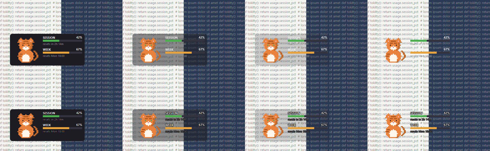
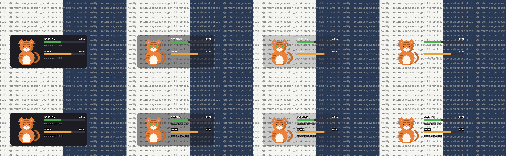
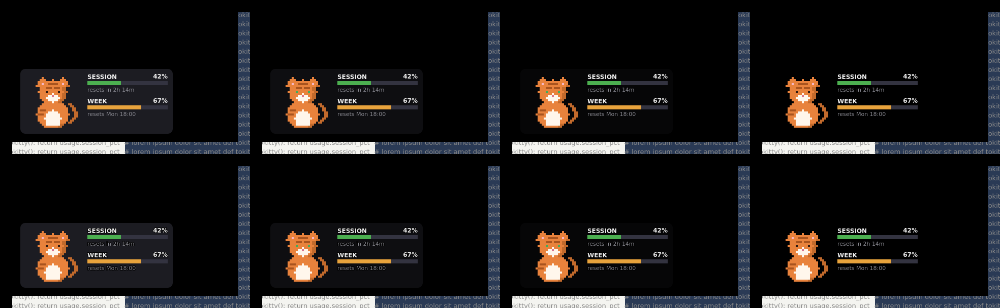
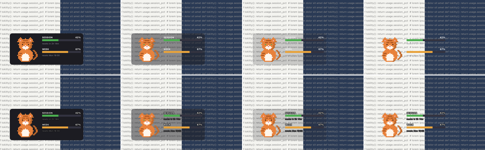

# PySide6 go/no-go spike (findings)

Issue: [#109](https://github.com/nickwolf/tokitty/issues/109), the spike for [#28](https://github.com/nickwolf/tokitty/issues/28). Brief: `docs/superpowers/handoffs/2026-10-09-pyside6-spike-brief.md`.

Status: Windows gates measured on Cucumber on 2026-10-10, at 100% and at real 150% display scaling. macOS and Linux builds measured on GitHub runners the same day. The Mac checklist was run on a real Mac on 2026-10-11, see "macOS results" at the end. Decision on 2026-10-11: go.

Everything here lives on the `spike/pyside6` branch only. Nothing merges.

## What was built

`spike/qt_card.py` is one frameless, always-on-top `QWidget` with `WA_TranslucentBackground`, 444x256 logical pixels, around a 300x128 card. The extra 16 px on the left and bottom, 112 px on top and 128 px on the right are where the cat can go. The card, the two bars and their labels are drawn with `QPainter`. The cat comes straight from `raster_rgba(frame, palette, round(SCALE * dpr))`, wrapped in a `QImage` with `setDevicePixelRatio(dpr)` and drawn at a position snapped to whole device pixels, so Qt never scales it. The cat can sit inside the card, on its top edge, beside it outside its rectangle, or walk along the top edge at 30 frames per second, mirrored on the way back. Drag moves the widget. Right-click opens a `QMenu` with position, card opacity (100, 80, 50, 20, 0), a "keep a 0% card clickable" toggle, an optional text halo, cat state, and Quit. A `QSystemTrayIcon` carries the same menu. The mouse wheel over the card changes opacity.

The window never takes keyboard focus, so there are no keyboard controls. The brief suggested keys, and they cannot work on a window that refuses focus.

`--selftest` checks pixel identity and saves the text screenshots. `--probe` (Windows only, `spike/probe_win.py`) does the hit testing, focus, drag and stacking checks. `--cpu N` measures the process's own CPU. `spike/cpu_measure.py` measures another process. `spike/qt_card.spec` is the PyInstaller spec, and `.github/workflows/spike-qt.yml` builds macOS and Linux on push to this branch.

Versions: PySide6-Essentials 6.12.0 (Qt 6.12.0), PyInstaller 6.22.3, Windows Python 3.13.2, Python 3.13 on the runners.

## Gate table

| # | Gate | Windows | macOS | Result |
|---|------|---------|-------|--------|
| 1 | Pixel identity | 0 mismatched pixels at 100% and 150% (real) and at 125, 150, 175, 200% (simulated), both `grab()` and screen capture, all four spots, both walk directions | 0 mismatched pixels on both runner types at dpr 1 and simulated dpr 2, `grab()` and screen capture, frozen build. Real Retina (dpr 2, cell 8): 0 mismatches in all 10 comparisons | Pass |
| 2 | Click-through on the empty margin | Margin and transparent sprite cells pass through. Cat, bars, card at 100/50/20% hit tokitty. A 0% card passes through | Fails. The whole 444x256 window catches clicks, margin and 0% card included. `setMask()` fixes the margin | Pass on Windows. Fail on macOS as built, fixable in Qt |
| 3 | Focus and stacking | Clicks and drags leave the foreground window alone. Stays above an active normal window | Stays on top of an active window. Clicking the cat makes the spike the frontmost app and Terminal loses keystrokes, frozen `LSUIElement` build too. Stays on its own Space and is hidden by full-screen apps | Pass on Windows. Fail on macOS |
| 4 | Drag and placement | Moves exactly as far as the mouse at 100% and at 150%, real and simulated | Drag works on the Retina display. No second monitor attached | Partial. No mixed-DPI pair on either machine |
| 5 | Text | Screenshots below | Screenshots below (runner and real Retina). Nick: the halo is needed for the labels and percentages, and makes the small reset text harder to read | Nick's call |
| 6 | macOS menu bar | Tray available, starts with no crash | Frozen `LSUIElement` build starts with the tray available and no crash on the runners. On a real Mac: `ApplicationType` is `UIElement`, no Dock icon, menu-bar icon present, its menu opens and Quit exits cleanly | Pass |
| 7 | CPU | Spike idle 0.086% of one core, walking 2.212%. tkinter 1.135% | Spike idle 0.283%, walking 7.211% at Retina. tkinter 0.983% | Pass. Spike idle is below tkinter on both. macOS walking is higher, see macOS results |
| 8 | Frozen size | Spike 23,840,377 bytes. Estimated real port about 36.3 MB | arm64 spike 22,988,015, x86_64 25,267,338. Estimated real port 32.3 MB and 35.2 MB | Bigger. See the section |
| 9 | Licence | Qt ships as separate DLLs | Qt ships as separate frameworks | Pass, with notices to add |

## 1. Pixel identity

The check takes the cat's rectangle from `QWidget.grab()` and from a real screen capture (`QScreen.grabWindow(0, ...)`), and compares it byte for byte with `raster_rgba` at the cell size for that scale (4, 5, 6, 7, 8 device pixels per sprite pixel at 100, 125, 150, 175, 200%). Opaque cells must match the palette exactly. Transparent cells must match the same capture with the cat hidden, which proves the empty cells are really empty. In the "beside" spot, where the cat is over the transparent margin, the whole RGBA block from `grab()` also has to equal `raster_rgba` exactly, alpha included, and it does.

Windows, real 100% (the only monitor here is a 2560x1440 at 100%): 10 comparisons, 5,440 opaque pixels each, 0 mismatches. Same result from the frozen build.

Windows, simulated 125, 150, 175 and 200% with `QT_SCALE_FACTOR`: 0 mismatches in all 40 comparisons. One run at 125% showed 2,663 changed pixels in transparent cells of the screen capture in the "beside" spot and none in opaque cells. Three reruns gave 0, so I put that down to something changing on screen behind the margin during the capture.

`QT_SCALE_FACTOR` exercises the same device-pixel-ratio path as a real 150% monitor inside Qt, but it is not the same as Windows telling the process its monitor is at 144 dpi. So I also switched the display to 150% for real (`DisplayConfigSetDeviceInfo`, the call the Settings app uses), ran `--selftest` from source and from the frozen build, and set it back to 100%. Qt reported the screen as 1707x960 at dpr 1.5 and `GetDpiForWindow` returned 144. Both runs: 10 comparisons, 12,240 opaque pixels each at cell size 6, 0 mismatches in opaque cells, 0 in transparent cells, and the exact RGBA block check in the "beside" spot passed.

macOS, frozen trimmed build on GitHub's `macos-15` (arm64, "Apple Virtual" 1024x768 display) and `macos-15-intel` ("Built-in Display" 1920x1080) runners: 0 mismatches in all 10 comparisons at dpr 1, and 0 in all 10 at dpr 2 simulated with `QT_SCALE_FACTOR=2` (cell size 8). Neither runner has a Retina panel, so a real Retina run is in the checklist.

The origin of the cat has to land on a whole device pixel, so positions are snapped with `round(v * dpr) / dpr`. All window margins are multiples of 4 for the same reason. And a screen capture taken right after a repaint can miss it on macOS, because the compositor there runs asynchronously. Windows' layered-window update shows up in the capture immediately. The first macOS run reported every opaque pixel wrong for exactly this reason, while the cat on screen was fine. Both matter for the port's own tests.

## 2. Click-through on the empty margin

Measured with `WindowFromPoint`, resolved through `GetAncestor(GA_ROOT)` and compared to the widget's HWND, the method #37 used. `true` means the click goes to tokitty.

| Point | 100% | 50% | 20% | 0%, alpha 1/255 | 0% |
|-------|------|-----|-----|-----------------|----|
| Empty margin, top right | false | false | false | false | false |
| Empty margin, left | false | false | false | false | false |
| Just outside the card's rounded corner | false | false | false | false | false |
| Empty area of the card | true | true | true | true | false |
| Bar fill | true | true | true | true | true |
| Opaque cat pixel | true | true | true | true | true |

With the cat beside the card, an opaque cat pixel hits tokitty, and a transparent cell inside the cat's bounding box resolves to the terminal window underneath. With the cat on the top edge, its opaque pixels hit tokitty. The same table came out identical at simulated 150% and at real 150%.

At exactly 0% the card is click-through, like the margin. Only painted pixels catch clicks: the bars, the cat, and the glyphs themselves. A pixel inside a letter of "SESSION" (alpha 255) hits tokitty, and the gap two pixels away (alpha 0) does not. So an invisible card can be dragged only by the cat or a bar, and right-clicked only there too.

Painting a 0% card at alpha 1/255 brings back hit testing over the whole card and is invisible to the eye. The port should do that: the lowest setting behaves like 0% visually and still behaves like a card under the mouse. If Nick would rather have true click-through at 0%, recovery needs the tray icon, which is now available on macOS too (gate 6), and #37's point still holds that the tray can be switched off.

Qt gives the window `WS_EX_LAYERED` and no `WS_EX_TRANSPARENT` (exstyle `0x8080088`), so the click-through comes from per-pixel alpha, not from a colour key. There is one window, so #37's problem of a click reordering two sibling topmost windows cannot happen.

## 3. Focus and stacking

Flags: `FramelessWindowHint | WindowStaysOnTopHint | Tool | WindowDoesNotAcceptFocus | NoDropShadowWindowHint`, plus `WA_ShowWithoutActivating`. The resulting exstyle has `WS_EX_TOPMOST`, `WS_EX_TOOLWINDOW` (no taskbar button), `WS_EX_LAYERED` and `WS_EX_NOACTIVATE`.

The probe sends real clicks with `SetCursorPos` and `mouse_event`, only to pixels tokitty owns, and compares `GetForegroundWindow()` before and after:

- Left click on the cat: the widget got the press, the terminal stayed in the foreground.
- Left click on the card: same.
- A 120x80 px drag starting on the cat: the window moved by exactly (120, 80), the terminal stayed in the foreground.
- Right click: while the `QMenu` is open, the menu popup is the foreground window. When it closes, the terminal is in the foreground again without anything restoring it. I didn't measure the Tk menu for comparison.
- With a normal window covering the widget and activated: the cat still hits tokitty (stays on top), the margin hits the normal window, and clicking the cat leaves the normal window in the foreground.

Results were identical at simulated 150% and at real 150%.

macOS Spaces and full-screen behaviour can only be checked on a real Mac. If the widget disappears when switching Spaces, the fix is `NSWindow.collectionBehavior` (`canJoinAllSpaces`, `fullScreenAuxiliary`), which Qt does not expose. That would mean `pyobjc` or a few lines of native code through `ctypes` and the Objective-C runtime, and it is a dependency decision for Nick. The spike also sets `WA_MacAlwaysShowToolWindow`, because a `Qt.Tool` window on macOS otherwise hides whenever the app is not active. That is from Qt's documentation and has not been tested on a Mac yet.

## 4. Drag and placement

Drag is a plain `move()` on mouse move, the same approach as the Tk widget. It moved by exactly the mouse delta at 100%, at simulated 150% and at real 150%.

Not tested: a mixed-DPI pair of monitors, because this machine has one. The spike rebuilds the cat image when the device pixel ratio changes (the image cache is keyed on it), so the cat should stay crisp after crossing, but that is untested. Checklist item.

## 5. Text

Card at 100, 50, 20 and 0%, over a backdrop that is light on the left and dark blue on the right with grey code-like text, Windows 100%. Top row as drawn today, bottom row with a 1 px dark halo around the text.



Over the dark half, every level is readable. Over the light half, the white labels and the grey reset text fade out from 50% down, and by 20% the reset text is gone. The halo keeps the labels readable at every level, at the cost of looking heavier at 100%. One option is to switch the halo on only below some opacity. Qt makes either approach a few lines of code, which Tk could not do on a translucent surface.

The same capture from the frozen build on the `macos-15` runner at simulated 2x, saved at device resolution:



Linux under xvfb, for completeness. Its pixel check also came out at 0 mismatches. There is no compositor there, so the translucent window comes out over black instead of the backdrop, which matches the brief's "Linux translucency is out of the gate":



## 6. macOS menu bar

On Windows `QSystemTrayIcon.isSystemTrayAvailable()` is true and the spike runs with the tray enabled without errors. I didn't open the tray menu by hand.

On both macOS runners the frozen `TokittyQtSpike.app`, with `LSUIElement` set in its `Info.plist` (confirmed with `plutil -p`), started with the tray enabled, reported `QSystemTrayIcon.isSystemTrayAvailable()` as true, animated for 8 seconds (9 frame ticks, 11 paints) and quit cleanly through `--quit-after`. So Qt's tray does not hit pystray's main-thread problem from #45. Whether the icon actually appears in the menu bar, whether its menu opens, and whether `LSUIElement` removes the Dock icon and the app menu bar are things only a person at a real Mac can see. Checklist items 8 and 9.

## 7. CPU

Each figure is over 60 seconds on Windows, as a percentage of one core (this machine has 8). `GetProcessTimes` on Windows counts in 15.625 ms ticks and can miss short wakeups altogether, and it read exactly 0.0 for the idle spike. So `spike/cpu_measure.py` also reads `QueryProcessCycleTime` and converts cycles with the rated 3,600 MHz clock. That conversion is an estimate, but it agreed with the tick count within about 15% wherever the ticks registered.

| Process | Ticks | Cycles | RSS |
|---------|-------|--------|-----|
| Spike, idle at 800 ms frames | 0.0% (0 s) | 0.086% (184,971,600 cycles) | 55.2 MB |
| Spike, cat walking at 30 fps | 1.927% | 2.212% | 55.9 MB |
| tkinter v0.6.0 from source, one pane, `TOKITTY_DEBUG_STATE=content` | 1.25% | 1.135% | 45.7 MB |
| Tokitty v0.5.0 frozen, Nick's live instance with real accounts | 11.51% | 11.404% | 102.1 MB |

The tkinter baseline ran with its state directory pointed at a scratch `LOCALAPPDATA`, so it had its own lock and settings and couldn't touch the running instance. Debug state draws one static pane with the 800 ms animation and no polling, which is the closest match to the spike. The live v0.5.0 figure is not like for like (real polling, several panes, hook activity), but it is high enough to look into separately.

The walking figure needed `Qt.PreciseTimer`. With the default coarse timer, a 33 ms interval ran at about 21 Hz (213 ticks in 10 s). With the precise timer it measured 31.5 paints per second.

## 8. Frozen size

One-folder PyInstaller builds from `spike/qt_card.spec`, zipped the way `release.yml` does it (`shutil.make_archive` on Windows, `ditto -c -k --keepParent` on macOS, `tar -czf` on Linux). "Trimmed" excludes the Qt Python modules the spike doesn't import and drops the software OpenGL fallback, translations, unused plugins and the Qt libraries for Network, QML, Quick, PDF, SVG and OpenGL.

| Target | v0.6.0 | Spike untrimmed | Spike trimmed |
|--------|--------|-----------------|---------------|
| windows-x64 | 22,417,629 | 36,882,925 | 23,840,377 |
| macos-arm64 | 18,982,047 | 27,772,372 | 22,988,015 |
| macos-x86_64 | 20,165,770 | 30,359,379 | 25,267,338 |
| linux-x86_64 | 38,795,809 | 73,968,762 | 68,344,927 |

The spike is not the app. It has no Pillow and no app code, and it has no Tcl/Tk either. To estimate a real Windows port I split the v0.6.0 zip by compressed size: Tcl/Tk is 2,761,926 bytes and Pillow is 6,708,785. Qt plus shiboken in the trimmed spike zip is 16,626,144. So a port that swaps Tk for Qt and keeps everything else comes to about 22,417,629 - 2,761,926 + 16,626,144 = 36,281,847 bytes, 62% bigger than v0.6.0. pystray is a few hundred kilobytes and is left in that estimate.

Pillow is used by the tray icon and by the Stream Dock key renderer. Under Qt, the tray icon comes from `QImage` and the key images could come from `QPainter`. If Pillow goes, the estimate drops to about 29,573,062 bytes, 32% over v0.6.0. That is a decision for #115.

Every update downloads the whole bundle (#115 says so), so this growth lands on every update, not just the first install.

The same split for every target, all in compressed bytes inside the archive:

| Target | v0.6.0 | Tcl/Tk in v0.6.0 | Pillow in v0.6.0 | Qt + shiboken in trimmed spike | Port estimate | Without Pillow |
|--------|--------|------------------|------------------|--------------------------------|---------------|----------------|
| windows-x64 | 22,417,629 | 2,761,926 | 6,708,785 | 16,626,144 | 36,281,847 (+61.8%) | 29,573,062 (+31.9%) |
| macos-arm64 | 18,982,047 | 2,275,002 | 4,400,245 | 15,573,058 | 32,280,103 (+70.1%) | 27,879,858 (+46.9%) |
| macos-x86_64 | 20,165,770 | 2,259,556 | 4,964,467 | 17,272,508 | 35,178,722 (+74.4%) | 30,214,255 (+49.8%) |

These are estimates by subtraction, not builds of a port. They assume the Python runtime and the app's own code cost the same under Qt as under Tk, which should hold closely since both builds use the same Python 3.13.

Trimming took two tries on macOS. PyInstaller's PySide6 hook collected `QtNetwork`, `QtDBus` and `QtSvg` frameworks even though the spike never imports them. Dropping `QtNetwork` and `QtSvg` worked. Dropping `QtDBus` made the frozen app fail at launch with `Library not loaded: @rpath/QtDBus`, because `QtGui` links it on macOS. On Linux the xcb platform plugin links it too. So QtDBus stays.

Linux built and ran its self-test under xvfb, which is all the gate asks. Its trimmed archive is still large because the PySide6 wheel's Qt links ICU (`libicudata.so.73` alone is 32,035,888 bytes unpacked) and PyInstaller pulls in GTK 3 for the platform theme plugin. Neither was pursued.

## 9. Licence

PySide6 and shiboken6 are LGPL-3.0-only (or GPL-2.0/GPL-3.0, or commercial), per the wheel metadata. In the one-folder build, Qt stays a set of separate, replaceable shared libraries:

- Windows: `_internal/PySide6/Qt6Core.dll`, `Qt6Gui.dll`, `Qt6Widgets.dll`, the plugin DLLs, and the binding modules `QtCore.pyd`, `QtGui.pyd`, `QtWidgets.pyd` plus `shiboken6`, all as plain files.
- macOS: `Contents/Frameworks/PySide6/Qt/lib/QtCore.framework`, `QtGui.framework`, `QtWidgets.framework`, linked by `@rpath` (`otool -L` on `QtWidgets.abi3.so` shows `@rpath/QtWidgets`, `@rpath/QtGui`, `@rpath/QtCore`, `@rpath/libpyside6.abi3.6.12.dylib`, `@rpath/libshiboken6.abi3.6.12.dylib`).

A user can replace any of those with their own build, which is what LGPL's relinking clause needs. The app's own code sits in PyInstaller's archive, which is fine because it is MIT and is not a modification of Qt.

The wheels themselves only include `LicenseRef-Qt-Commercial.txt`, not the LGPL text, so a release has to add these:

1. The LGPL-3.0 text and the GPL-3.0 text it incorporates.
2. A notice that the bundle contains Qt 6.12.0 and PySide6/shiboken6 6.12.0 under LGPL-3.0, with a link to the corresponding source (the Qt and PySide6 source releases for that exact version).
3. The third-party notices for the Qt modules shipped. From Qt's "Licenses Used in Qt" page (fetched 2026-10-10, which tracks the current Qt 6 release, so regenerate it for the shipped version): Qt Core bundles zlib, double-conversion, PCRE2 and sljit, TinyCBOR, the Unicode Character Database and CLDR, forkfd, tl::expected, Apache Tika MIME definitions, BLAKE2, SipHash, SHA-1/SHA-3/SHA-384/SHA-512, MD4/MD5 and Robert Penner's easing equations. Qt GUI bundles FreeType 2, HarfBuzz-NG, libpng, libjpeg-turbo, MD4C, Pixman, the Adobe Glyph List, the DejaVu fonts, the sRGB ICC profile, the Emoji Segmenter, Vulkan and D3D12 allocator headers, OpenGL headers, WebGradients, the Wintab API (Windows) and the Cocoa platform plugin (macOS). Qt Widgets lists none of its own.
4. A short statement in the About text or README saying how to replace the Qt libraries.

`freeze/` would carry these as data files and the spec would copy them next to the executable. That belongs in #115.

## Corrections to the brief

The brief asked for its own claims to be treated as hypotheses. These turned out wrong or incomplete:

- A temporary `workflow_dispatch` workflow on the spike branch cannot be started. GitHub only dispatches workflows that exist on the default branch (`HTTP 404: workflow spike-qt.yml not found on the default branch`). The workflow runs on push to `spike/pyside6` instead.
- Keyboard controls can't work on a window with `WindowDoesNotAcceptFocus`. Everything went on the menus.
- On Windows a venv's `python.exe` is a launcher that starts the real interpreter as a child process, so the PID a shell sees is not the process doing the work. Measure the PID the script reports from `os.getpid()`.
- A 33 ms `QTimer` does not give 30 fps unless it is a `PreciseTimer`.

## Changes to the #28 sub-issues

- #110/#111: draw the lowest opacity at alpha 1/255 rather than 0, or decide on purpose that 0% is click-through and lean on the tray. Snap every sprite position to whole device pixels and keep window margins at multiples of 4. Pre-render each frame at `round(SCALE * dpr)` and key the cache on the device pixel ratio. Use `Qt.PreciseTimer` for anything animating faster than about 15 fps.
- #111: on macOS, per-pixel alpha does not give click-through, so set a `setMask()` from the card and the cat (ideally the cat image's alpha through `QImage.createAlphaMask()`), updated when the cat moves, and leave a 0% card out of it unless "Keep 0% card clickable" is on. Add a small macOS-only native helper that calls `_setPreventsActivation:YES` (guarded by `respondsToSelector:`, falling back to today's behaviour) and sets `collectionBehavior` to `canJoinAllSpaces | fullScreenAuxiliary`. The focus half is proven through `ctypes`; the Spaces half is untried.
- #111: consider the text halo as a theme option, or switch it on automatically below some opacity. On the Mac the halo helps the labels and percentages at low opacity but hurts the small reset text, so it may need to skip that line (gate 5).
- #114: `QSystemTrayIcon` works on Windows and on a real Mac from a frozen `LSUIElement` bundle (icon, menu and Quit all checked). pystray can go. That also takes `pyobjc` out of the macOS build, since pystray is what pulls it in today (`tokitty/ui.py` imports `AppKit` for the About panel only because it's already there). The native helper should use `ctypes`, which the focus run proved, rather than keep `pyobjc` for one call.
- #115: the size growth is the biggest cost found. Windows is about +62% with Pillow kept, about +32% if Pillow is replaced by `QImage`/`QPainter`, and macOS about +70 to 74% or +47 to 50%. Plan on replacing Pillow. Add the licence files listed above. Trim in the spec by file name, because PyInstaller's PySide6 hook collects QtNetwork, QtDBus and QtSvg frameworks on macOS even when they are never imported, and keep QtDBus, which QtGui links on macOS and the xcb plugin links on Linux.
- #117: add `--selftest`-style pixel checks at real 150% on Windows and on a Retina Mac. Screen-capture comparisons have to wait for the compositor on macOS. Add the macOS click-through, focus and Spaces checks, the focus fix in the frozen `LSUIElement` build with real typing, and a mixed-DPI drag, none of which have been run yet.

## Decision

Go, decided by Nick on 2026-10-11.

On Windows every gate that can be measured on one monitor passed, at 100% and at real 150%: the cat is byte-identical to `raster_rgba`, the empty margin and transparent sprite cells click through, focus stays with the terminal, the widget stays on top, and it idles at 0.086% of one core against 1.135% for today's tkinter widget. On a real Mac the cat is byte-identical at Retina, the menu-bar icon and `LSUIElement` work, and it idles at 0.283% against 0.983% for tkinter. The three macOS failures each have a fix: `setMask()` for click-through inside Qt, `_setPreventsActivation:` through `ctypes` for focus (proven), and `collectionBehavior` through the same helper for Spaces (public API, untried).

The costs taken on with the go:

1. Size. Roughly +32% on Windows and +47 to 50% on macOS with Pillow replaced, more if it stays. Every update pays it.
2. A private AppKit method for macOS focus, guarded so a future macOS that drops it falls back to today's behaviour instead of breaking.
3. Walking at 30 fps costs 7.211% of one core on the Mac (2.212% on Windows). Idle is what runs most of the time, but the walk rate may want tuning.

## Mac checklist for Nick

From a clone, on the spike branch:

```
git fetch origin spike/pyside6 && git checkout spike/pyside6
python3 -m venv .venv && .venv/bin/pip install PySide6-Essentials
.venv/bin/python spike/qt_card.py
```

1. A card with a cat appears and the cat blinks or moves about every 0.8 s. Running from source, a Dock icon and an app menu will probably appear. That's expected, and item 9 checks the frozen build.
2. Look at the cat up close on the Retina display. Every sprite pixel should be a crisp 2x2 block of device pixels with no blur at the edges. Then run `.venv/bin/python spike/qt_card.py --selftest` and send me `spike/out/selftest_darwin.json` and the `text_darwin_*.png` files. If macOS asks for Screen Recording permission for Terminal, allow it, because the screen half of the check needs it.
3. Put a Finder window behind the widget. Click on the empty area above the card (where the cat goes when it's on the top edge, with the cat inside the card) and check the click lands on Finder. Click on the cat, a bar and the card: each should reach tokitty (drag starts, or right-click opens the menu).
4. Right-click, Card opacity, 0%. Click the empty card area: it should go through to Finder. Turn on "Keep 0% card clickable" and click again: it should now catch the click.
5. With Terminal focused and a command half typed, click the cat and drag the widget. Keep typing: the keystrokes should still go to Terminal.
6. Activate another app's window over the widget's position: the widget should stay on top.
7. Switch to another Space (Ctrl+Right). Does the widget follow, stay on the first Space, or vanish? Then put an app in full screen. Is the widget visible over it?
8. Look for the cat in the menu bar. Click it: the menu should open and Quit should work. Note any crash or missing icon.
9. Build the bundle with `.venv/bin/pip install pyinstaller && .venv/bin/python -m PyInstaller spike/qt_card.spec --noconfirm` and open `dist/TokittyQtSpike.app`. It has `LSUIElement` set. Check: no Dock icon, no app menu at the top of the screen, menu-bar item still there. For the comparison, build again with `SPIKE_LSUIELEMENT=0` in front of the same command, which should show both.
10. Activity Monitor, CPU column, for about a minute: once with the cat inside the card, once with Cat position, walk. Note both figures, and the same for the current Tokitty if it's running.
11. Card opacity at 100, 50, 20 and 0% over a light window and over a dark one, with and without "Text halo". Screenshots, or just your opinion.

## macOS results

Run on 2026-10-11 on a MacBook Air (Mac17,3, Apple M5, 10 cores, 16 GB), macOS 26.6.2 (25G83), built-in Liquid Retina display at 2560x1664, which Qt reports as 1710x1112 at dpr 2.0. No external monitor was attached. Python 3.13.14 in a separate venv with PySide6-Essentials 6.12.0 and PyInstaller 6.22.3, the same versions as the Windows run.

Nick's installed Tokitty v0.6.0 has an orange cat too, and early on he clicked it by mistake while testing the spike. The from-source runs below therefore use the spike with a gray tabby palette, swapped in by a wrapper script outside the repo that replaces `get_palette` and changes nothing else. For the frozen-build checks Nick's installed Tokitty was quit, so the orange spike cat was the only cat on screen.

| # | Item | Result | Detail |
|---|------|--------|--------|
| 1 | Card appears and animates | Pass | Gray cat, frame change about every 0.8 s. From source a Dock icon and a "Python" app menu appear, as expected |
| 2 | Retina crispness and `--selftest` | Pass | Nick: crisp square pixels. Self-test: 10 of 10 comparisons with 0 mismatches, details below |
| 3 | Click-through on the empty margin | Fail | A click on the empty strip above the card does not reach Finder, and a right-click there opens the spike menu. The cat, bars and card all catch clicks |
| 4 | 0% card, then "Keep 0% card clickable" | Fail | The 0% card catches clicks with the toggle off and on, same cause as item 3 |
| 5 | Focus stays with Terminal | Fail | Clicking the cat makes the spike the frontmost app, from source and from the frozen `LSUIElement` build. Keystrokes stop reaching Terminal. A `ctypes` call to `_setPreventsActivation:` fixed it in a follow-up run |
| 6 | Stays above an active window | Pass | The widget stays above another app's active window |
| 7 | Spaces and full screen | Fail | The widget stays on the Space it was opened on and does not follow to another Space. It is not visible over a full-screen app |
| 8 | Menu-bar icon | Pass | Icon appears in the menu bar, its menu opens, Quit exits cleanly, no crash report |
| 9 | `LSUIElement` | Pass | Default build: `LSUIElement => true` in the plist, `ApplicationType` `UIElement`, no Dock icon, menu-bar icon present. `SPIKE_LSUIELEMENT=0` build: no `LSUIElement` key, `ApplicationType` `Foreground` |
| 10 | CPU | Measured | Spike idle 0.283% of one core, walking 7.211%. tkinter v0.6.0 from source 0.983%. Installed Tokitty v0.6.0 3.282%. Details below |
| 11 | Text at 100, 50, 20, 0% | Nick's call | Nick: the halo is needed for "SESSION", "WEEK" and the percentages to read at low opacity, but the small "resets in..." text is harder to read with the halo and fine without it |
| Gate 4 | Mixed-DPI drag | Not run | No second monitor attached |

### Pixel identity on real Retina

`.venv/bin/python spike/qt_card.py --selftest --out spike/out/mac`, from source. Qt reported one screen, "Built-in Retina Display", geometry 0,0 1710x1112, dpr 2.0. Every comparison used cell size 8 and a 888x512 device-pixel image, with 21,760 opaque pixels per comparison.

| Spot | Mirrored | Cat device origin | `grab()` opaque / transparent mismatches | Screen opaque / transparent mismatches | Exact RGBA block |
|------|----------|-------------------|------------------------------------------|----------------------------------------|------------------|
| inside | no | 52, 248 | 0 / 0 | 0 / 0 | n/a |
| on_top | no | 80, 24 | 0 / 0 | 0 / 0 | n/a |
| beside | no | 648, 272 | 0 / 0 | 0 / 0 | true (`grab()`) |
| walk | no | 152, 24 | 0 / 0 | 0 / 0 | n/a |
| walk | yes | 152, 24 | 0 / 0 | 0 / 0 | n/a |

macOS did not ask for Screen Recording permission and the screen half still passed. macOS lets an app capture its own windows without that permission, which is enough for the cat's rectangle. The compositor timing problem from section 1 did not show up.

The text screenshots from the same run, at device resolution, top row as drawn today, bottom row with the halo:



### Click-through (items 3 and 4)

On macOS the per-pixel alpha that gives click-through on Windows does nothing. The whole 444x256 window catches the mouse, and Qt delivers the events (a right-click on the empty margin opens the spike's menu). So the margin, transparent sprite cells and a 0% card all block whatever is underneath.

As an experiment outside the spike, a wrapper called `QWidget.setMask()` with the card rectangle plus the cat's bounding rectangle, updated after each paint when the cat moves. With that mask a click on the empty margin reached Finder, and Nick saw no clipping of the card's rounded corners or of the cat. So the fix is in Qt and needs no new dependency. The port would build the mask on macOS only. A rectangle mask still catches clicks on transparent cells inside the cat's box and just outside the card's rounded corners; a mask built from the cat image's alpha (`QImage.createAlphaMask()`) would match Windows more closely. A 0% card would have to be left out of the mask to keep the Windows behaviour, and put back when "Keep 0% card clickable" is on. Changing the mask 30 times a second while walking was not measured for CPU.

### Focus (item 5)

`WindowDoesNotAcceptFocus` keeps the window from becoming key, but macOS still activates the whole app on a click. A background logger polled `lsappinfo front` every 0.2 s during the frozen-build test. Each click on the cat switched the frontmost app from Terminal to TokittyQtSpike (15:11:01, 15:11:06, 15:11:12), and it went back to Terminal only when Nick clicked into Terminal again. `LSUIElement` hides the Dock icon and app menu but does not stop the activation.

Follow-up run the same day, without Nick at the keyboard. A wrapper outside the repo reached the spike's `NSWindow` through `ctypes` and `objc_msgSend` (`winId()` is the `NSView`, `[view window]` is the window, class `QNSPanel`, `styleMask` 14, `canBecomeKeyWindow` false). A harness activated Terminal, posted a synthetic left click on the cat with `CGEventPost`, then a 40x20 drag in 20 steps, and read `lsappinfo front` 1 s after each. The spike ran from source, so it is a normal `Foreground` app, which is the harder case for activation than the `LSUIElement` bundle.

| Variant | Click: frontmost before, after | Drag: frontmost before, after | Spike got both presses | Drag moved the widget |
|---------|-------------------------------|-------------------------------|------------------------|-----------------------|
| As built, run 1 | Terminal, python | Terminal, python | yes | not logged |
| As built, run 2 | Terminal, python | Terminal, python | yes | 600,280 to 640,300 |
| `NSWindowStyleMaskNonactivatingPanel` added (`styleMask` 14 to 142) | Terminal, python | Terminal, python | yes | not logged |
| `_setPreventsActivation:YES` only | Terminal, Terminal | Terminal, Terminal | yes | 600,280 to 640,300 |
| Both, run 1 | Terminal, Terminal | Terminal, Terminal | yes | not logged |
| Both, runs 2 and 3 | Terminal, Terminal | Terminal, Terminal | yes | 600,280 to 640,300 |

The public style flag does nothing when it is set after Qt has created the window, which is the only point at which Python can reach it. The private `_setPreventsActivation:` is what stops the activation, and it is enough on its own. The click and the drag still reach the widget, and the drag moves it by exactly the mouse delta. So focus is fixable with `ctypes` and no new dependency, but through an undocumented AppKit method that Apple could change or remove in a later macOS. The port should check `respondsToSelector:` first, as the wrapper did, and fall back to today's behaviour. Not yet tried with the frozen `LSUIElement` build or typed keystrokes; the frontmost app stands in for where keystrokes go.

### Spaces and full screen (item 7)

The widget stays on the Space it opened on and is not visible over a full-screen app. As section 3 predicted, `WA_MacAlwaysShowToolWindow` is not enough. The fix is `NSWindow.collectionBehavior` with `canJoinAllSpaces` and `fullScreenAuxiliary`, which Qt does not expose. So the port needs `pyobjc` or a small `ctypes` call into the Objective-C runtime, and that is Nick's dependency decision. The focus follow-up shows that the `ctypes` route reaches Qt's window without any new package, so one small helper could set the collection behaviour and prevent activation together. The collection behaviour itself was not tried.

### CPU (item 10)

Each figure is the change in `ps -o time=` for the PID over 60 seconds, as a percentage of one core, after a 5 second warmup, from source with `--no-tray`. The PID the script printed matched the measured process, because a macOS venv's `python` is a symlink and not a launcher. The spike's own `--cpu 60` was run right after as a cross-check.

| Process | `ps` CPU over 60 s | Percent of one core | `--cpu 60` cross-check | RSS |
|---------|--------------------|---------------------|------------------------|-----|
| Spike, cat inside the card | 0.17 s over 60.03 s | 0.283% | 0.326% (0.195 s), 1.3 paints/s | 112,752 KB |
| Spike, cat walking | 4.33 s over 60.04 s | 7.211% | 7.119% (4.272 s), 31.4 paints/s | 115,248 KB |
| Installed Tokitty v0.6.0, Nick's live instance | 1.97 s over 60.03 s | 3.282% | n/a | 138,464 KB |
| tkinter v0.6.0 from source, `TOKITTY_DEBUG_STATE=content`, run 1 | 0.59 s over 60.04 s | 0.983% | n/a | 150,224 KB |
| Same process, run 2 | 0.56 s over 60.04 s | 0.933% | n/a | 152,464 KB |

The installed Tokitty ran alongside the idle spike measurement. Like the Windows v0.5.0 figure it is not like for like (real polling, live accounts).

The tkinter baseline was measured in a follow-up run, set up like the Windows one: the `tokitty/` code on this branch (identical to v0.6.0) from source in a Python 3.13.14 venv with Tk 9.0, Pillow 12.3.0 and pystray, debug state `content`, one pane, no polling. macOS has no environment variable for the state directory, so `HOME` pointed at a scratch directory and the run had its own lock and settings while Nick's instance kept running. Two back-to-back 60 s windows on the same process gave 0.983% and 0.933%.

At idle the spike (0.283%, 0.326% cross-check) uses about a third of what tkinter does, the same direction as on Windows (0.086% against 1.135%). Walking has no tkinter equivalent. It costs about 3.3 times the Windows figure (2.212%). Each frame paints 4 times as many device pixels at dpr 2, which accounts for some of that, but nothing here separates the causes.

### What this changes

Leaving the go/no-go to Nick. These results do change the macOS picture from the earlier recommendation, which expected only Spaces to be at risk:

1. Click-through fails on macOS as built. `setMask()` fixes it inside Qt, so it adds work to #110/#111 and needs no dependency.
2. Focus fails on macOS. Clicking the widget steals keyboard focus from the terminal. A `ctypes` call to the private `_setPreventsActivation:` fixed it in the follow-up run with no new package, at the cost of relying on undocumented AppKit.
3. Spaces and full screen fail, as predicted. So a Mac port that behaves like the Windows one needs native calls for two separate things. The focus run shows `ctypes` can do it without `pyobjc`. Today's macOS build already ships `pyobjc` (pystray pulls it in), but the port drops pystray, so `ctypes` avoids keeping it for one helper. The real question is whether a private method is acceptable.
4. Walking at 30 fps costs 7.211% of one core on this Mac, against 2.212% on Windows. Idle stays low at 0.283%, against 0.983% for today's tkinter widget.

Pixel identity on real Retina, the menu-bar icon and `LSUIElement` all passed. Still untried on the Mac: `collectionBehavior` through `ctypes` for Spaces, the focus fix in the frozen `LSUIElement` build with real typing, and a mixed-DPI drag.
